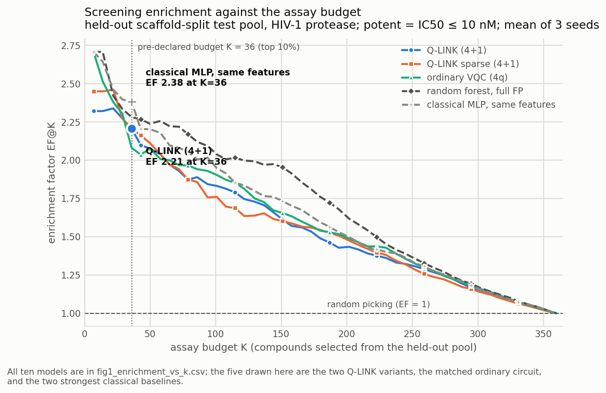
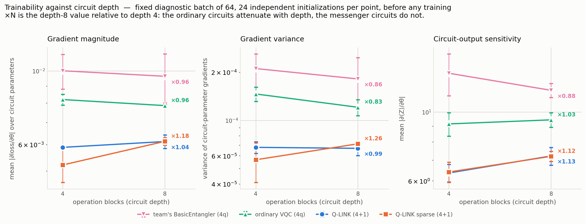
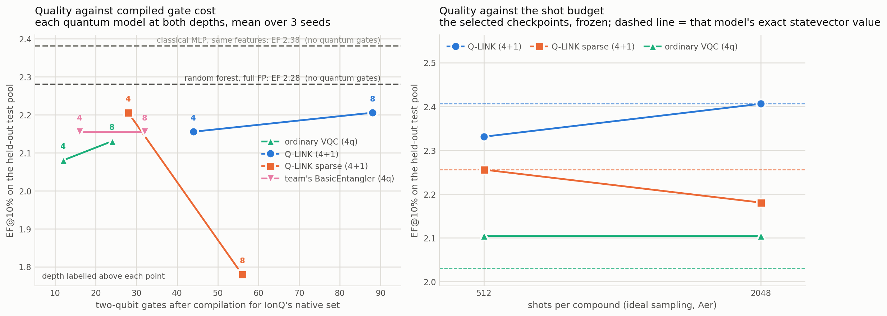
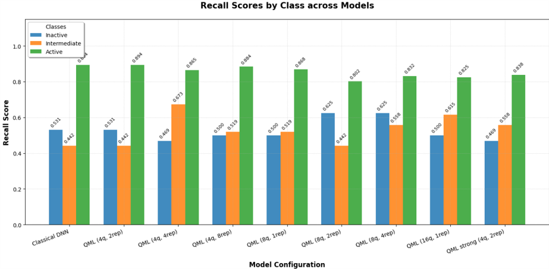
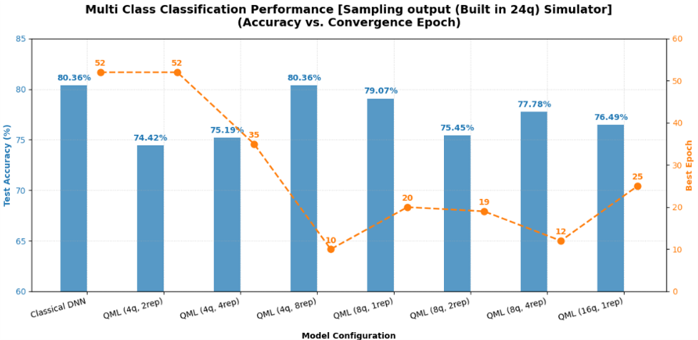

# Q-Link Screen

**Can a messenger qubit improve compound prioritization?**
Theme: **Quantum Impact** · Built with Qiskit, runs on Qollab's IonQ simulators.

This effort is supported by Qollab & IonQ.

---

## The question

A screening team has a fixed number of assay slots. Given a pool of candidate compounds against
**HIV-1 protease** (ChEMBL target `CHEMBL243`), rank them so the first batch sent to the bench contains
as many genuinely potent compounds as possible.

We take **Q-LINK** ([arXiv:2604.11831](https://arxiv.org/abs/2604.11831)) — a variational-circuit design
that adds one *messenger* qubit to carry information across layers — and ask two things:

1. Does the messenger improve compound prioritization against a matched ordinary circuit?
2. **Our extension:** can the messenger couple to the data qubits only every *second* block
   (the "sparse messenger") and keep the benefit at a fraction of the entangling-gate cost?

The answers are below, including the ones that did not go our way.

---

## Results

Held-out **scaffold-split** test pool: 360 compounds, 133 potent. Potent = median IC50 ≤ 10 nM.
Budget **K = 36** (top 10 %), declared before any test evaluation. 3 seeds; test split read once.

| model | features | EF@10 % | hits@36 | PR-AUC | params | 2q gates (IonQ) |
|---|---|---|---|---|---|---|
| classical MLP | compact 16 | **2.38 ± 0.16** | 31.7 | 0.736 | 3 201 | – |
| team's DNN | full fingerprints | 2.33 ± 0.08 | 31.0 | 0.757 | 347 649 | – |
| random forest | full fingerprints | 2.28 ± 0.04 | 30.3 | **0.782** | – | – |
| **Q-LINK (4+1), 8 blocks** | compact 16 | 2.21 ± 0.17 | 29.3 | 0.680 | 169 | 88 |
| **Q-LINK sparse (4+1), 4 blocks** | compact 16 | 2.21 ± 0.16 | 29.3 | 0.675 | 121 | **28** |
| team's BasicEntangler (4q) | compact 16 | 2.16 ± 0.11 | 28.7 | 0.672 | 89 | 16 |
| classical 4-wide bottleneck | compact 16 | 2.11 ± 0.15 | 28.0 | 0.674 | 93 | – |
| ordinary VQC (4q) | compact 16 | 2.08 ± 0.04 | 27.7 | 0.704 | 121 | 12 |
| ordinary VQC (5q idle control) | compact 16 | 2.08 ± 0.04 | 27.7 | 0.699 | 121 | 12 |
| random ranking | – | 0.88 | 11.7 | 0.365 | 0 | 0 |

### What we can claim

**1. The messenger helps a little, and the extra qubit is not what does it.**
At matched depth, Q-LINK beats the ordinary circuit by **+0.075 EF** at depth 4 *and* at depth 8 —
about one extra potent compound per 36 assays. The 5-qubit control, which adds an idle qubit carrying no
feature, is **numerically identical to the 4-qubit circuit** (EF 2.08 vs 2.08, and equal to 4 decimals on
validation). So whatever Q-LINK gains comes from the *messenger interactions*, not from a wider Hilbert
space. That control is the most trustworthy result here.

**2. The gain does not survive as a general ranking improvement.** Q-LINK's PR-AUC is *lower* than the
ordinary circuit's (0.680 vs 0.704). It sharpens the very top of the ranking slightly while being no
better, or worse, over the whole list. With 3 seeds and EF quantized in steps of 0.075, the bootstrap
interval on the selected-configuration comparison is `[0.000, +0.376]` — consistent with a small real
effect and also with noise. **We do not claim Q-LINK improves screening.**

**3. Our sparse-messenger extension works at depth 4 and fails at depth 8.**

| | EF@10 % | 2q gates | verdict |
|---|---|---|---|
| Q-LINK, 4 blocks | 2.16 | 44 | |
| **Q-LINK sparse, 4 blocks** | **2.21** | **28** | better quality, 36 % fewer gates |
| Q-LINK, 8 blocks | 2.21 | 88 | |
| Q-LINK sparse, 8 blocks | 1.78 | 56 | **−0.43 EF, all 3 seeds worse** |

Sparse Q-LINK at 4 blocks matches full Q-LINK at 8 blocks on EF using **28 compiled two-qubit gates
instead of 88** — a 3.1× saving at equal quality. But at 8 blocks, skipping every other coupling costs
0.43 EF on every seed. The messenger can be refreshed half as often in a shallow circuit; in a deeper one
it cannot. Validation selected the right configuration (sparse at depth 4) without seeing the test set.

**4. No quantum advantage, and the bottleneck is the features, not the circuit.**
A plain classical MLP on the *identical* 16-dimensional features beats every quantum model (2.38 vs 2.21),
and a random forest on full fingerprints is far ahead on PR-AUC (0.782 vs 0.680). A classical 4-wide
bottleneck — the same graph with the circuit replaced by a classical layer — scores 2.11, within noise of
the quantum circuits. **At this scale the quantum block is doing roughly what a classical layer of the
same width does.**

**5. There is no barren plateau at this scale, so this benchmark cannot test the paper's central claim.**
Gradients are healthy everywhere (mean |∂L/∂θ| ≈ 6 × 10⁻³ to 1 × 10⁻², variance ≈ 10⁻⁴). Q-LINK has
*smaller* absolute gradients than the ordinary circuit, but its gradients do **not** attenuate with depth
(×1.04 from 4→8 blocks, sparse ×1.18) while the ordinary circuits' do (×0.96). The direction matches the
paper; the magnitude is nowhere near a plateau. The paper's regime was 8–10 qubits at depth n²·log n
(≈ 133–230 blocks); ours is 5 qubits at 4–8 blocks. **We neither confirm nor refute the paper.**

**6. Finite shots are not the obstacle.** At 512 shots per compound the top-36 selection overlaps the
exact-statevector selection by 92–97 %, and EF is within 0.08. Ranking tolerates shot noise well, because
it only needs the ordering.

### On the team's "77–80 % accuracy plateau"

The sweep was not stuck — **accuracy on that task cannot move**. The 3-class test set is 78.29 % "active",
so predicting "active" for everything scores 78.29 %. Every configuration tried (4q/2, 4q/4, 4q/8, 8q/1,
8q/2, 8q/4, 16q/1, basic and strong entangler) lands between 73.9 % and 80.4 % — within a couple of points
of free. Meanwhile the discriminative metrics *did* move: the 8q/4 run has the lowest accuracy of the deep
runs (0.778) and the **best** balanced accuracy (0.671), macro-F1 (0.626) and AUC (0.860). Ranking by
accuracy pointed the search away from the best model. Full analysis: **[docs/AUDIT.md](docs/AUDIT.md)**.

---

## Evidence figures

| | |
|---|---|
|  | **Fig 1** — enrichment against assay budget K, averaged over 3 seeds. |
|  | **Fig 2** — gradient magnitude, variance and circuit-output sensitivity vs depth, 24 independent initializations per point, before training. |
|  | **Fig 3** — quality against compiled two-qubit gate count and against shot budget. |

Every plotted value is also written as a `.csv` beside the figure, and every number traces to a run file
in `results/runs/`.

### The three-class sweep (companion work)

| | |
|---|---|
|  | **Fig 5** — per-class recall for every configuration. This is the view accuracy hides: the active class is recovered at 0.80–0.89 while inactive sits near 0.50 and intermediate swings from 0.44 to 0.67. The mean of the three bars is balanced accuracy, which is what separates these models. |
|  | **Fig 6** — accuracy against convergence epoch on the built-in sampling simulator. The accuracies here were produced by running the saved weights (4q/2rep 74.42 %, 4q/8rep 80.36 %), and agree with the exact values recomputed in the `hybrids` demo. Read them against the 78.29 % majority-class rate: only 4q/8rep and 8q/1rep clear it. |

Two further figures from the same sweep, `multiclass_benchmark_statevector_sim.png` and
`multiclass_benchmark_ION_realdevice_sim.png`, are kept in `figures/` but are not shown here — see
[docs/AUDIT.md](docs/AUDIT.md) for why.


---

## Run it

### On Qollab (the submitted demo)

The `qollab/` folder is the project. Press **Run**, pick a backend in the **Select QPU** dialog — the
built-in simulator, or **IonQ Forte 1 / Aria** under remote simulators — and set shots under Run settings.

The demo explains the target, ranks a 60-compound held-out pool with exact expectations, compares the
ranking against a random forest and random picking, shows the shortlist with its real assay labels, then
**executes the same quantum inference path live on the backend you chose** for a selectable batch and
prints the sampled expectations beside the exact ones. It loads trained weights (training is not run in
the browser) and says so; nothing printed under the live-run heading is cached.

```
qollab/
  main.py              demo entry point; main(shots, backend_batch, budget_percent)
  qlink_circuit.py     the Q-LINK circuit in Qiskit, no torch
  model_qlink.json     trained weights, exported from results/runs/
  pool.json            60 held-out compounds with features and assay labels
  classical_scores.json  random-forest scores for the same compounds
  requirements.txt     qiskit>=2.5.2,<3.0.0
```

IonQ accepts one job per run, so the demo submits all its circuits in a single `backend.run(list, shots)`.

### Locally (the full experiment)

```bash
python -m venv .venv && .venv/Scripts/pip install -r requirements.txt

python -m qlink_screen.tests                 # 9 correctness checks, must be 9/9
python -m qlink_screen.data                  # rebuild data/v2 from the team's raw ChEMBL pull
python -m qlink_screen.baselines --task potent
python -m qlink_screen.train --task potent --models mlp mlp_bneck dnn_fp --seeds 0 1 2
python -m qlink_screen.train --task potent --models be4 van4 van5 qlink qlink_sparse \
                             --depths 4 8 --seeds 0 1 2
python -m qlink_screen.evaluate              # validation summary + depth selection (test untouched)
python -m qlink_screen.evaluate --final      # the single locked test pass
python -m qlink_screen.evaluate --shots      # finite-shot inference via Aer
python -m qlink_screen.figures
python -m qlink_screen.export_qollab --run potent__qlink__d4__s0
```

Whole grid: about 9 minutes on 24 CPU threads. `--task class3` repeats everything on the team's original
three-class task.

To reproduce the **original** notebooks instead, open them from `classical/` and `quantum/` in Colab —
they are unmodified and carry their own saved outputs.

### The companion evaluation (`qollab/ramqolab/`)

A second, self-contained Qollab project that scores the team's seven BasicEntangler hybrids on the
original three-class test set: exact expectation values for all seven locally, then a live backend run.
Because IonQ accepts one job per run, it packs models side by side into a single circuit and splits the
plan into parts — on IonQ, run `part=0` then `part=1` to cover all seven. Its summary prints every
accuracy against the 0.7829 majority-class rate, and only one of the seven models beats it:

| model | accuracy | vs. answering "active" every time |
|---|---|---|
| 4 qubits, 8 reps | 0.8036 | **+0.0207** |
| 8 qubits, 1 rep | 0.7907 | +0.0078 |
| 8 qubits, 4 reps | 0.7778 | −0.0051 |
| 16 qubits, 1 rep | 0.7700 | −0.0129 |
| 4 qubits, 4 reps | 0.7494 | −0.0335 |
| 4 qubits, 2 reps | 0.7442 | −0.0387 |
| 8 qubits, 2 reps | 0.7390 | −0.0439 |

This also re-measures the 4-qubit/2-rep model at **0.7442**, not the 0.8036 printed in its notebook —
that figure was the classical DNN's, printed from a stale variable (see [AUDIT §3 item 9](docs/AUDIT.md)).

---

## How it works

**Data.** The team's raw ChEMBL pull for `CHEMBL243` → enzymatic assays only → exact `=` nM values →
ChEMBL-flagged rows dropped → RDKit-standardized parents → median pIC50 per InChIKey → **2 403 compounds**.
Randomized Bemis–Murcko **scaffold split** 70/15/15, asserted disjoint, frozen in `data/v2/splits.csv`.
Features: PaDEL PubChem fingerprints → variance filter → PCA(16) → standardize, **all fit on train only**.
Full fingerprints (ECFP4-2048 + PubChem-881) are kept for the strong classical baselines, so we can see
whether compression is the limitation. It is.

**Circuits** (`qlink_screen/circuits.py`) follow the authors' reference implementation
([AARC-lab/DCAS_2026_QLINK](https://github.com/AARC-lab/DCAS_2026_QLINK), TensorCircuit) gate for gate:

```
messenger: H
RXX(π/4) from every data qubit to the messenger        ← collection
per block:  RZ, RY, RX on each data qubit;  CZ chain
            CNOT(messenger → each data qubit)          ← distribution
            RXX(π/4) collection again, unless last block
```

Qiskit's `RXXGate` is `exp(-iθ/2·X⊗X)`, identical to TensorCircuit's `rxx`, so π/4 carries over — checked
numerically, not assumed. The messenger is never measured or reset and is excluded from the observables.

**Two declared departures from the paper:** the input is an RX angle encoding of four classical features
rather than a random quantum state, and the objective is supervised cross-entropy on ⟨Z⟩ read-outs rather
than the paper's ground-state cost. We implemented the method from the paper and the reference repository
(which shows an MIT badge but ships no LICENSE file, so we did not copy its code).

**Execution.** `qlink_screen/quantum.py` compiles a Qiskit `QuantumCircuit` into batched torch statevector
operations, so training differentiates **the same circuit object** the demo submits to IonQ. Gradients are
exact autograd through the amplitudes; the chain rule into the classical head is autograd's, never the
shift rule applied to the loss. `qlink_screen/tests.py` checks amplitudes and ⟨Z⟩ against Qiskit's
`Statevector` and `StatevectorEstimator`, batching, input/weight dependence, finite-difference gradients,
and the structural properties of each circuit. **9/9 pass.**

---

## Honest limits

- **4+1 qubits is classically simulable.** Everything here is an architecture comparison on a real assay
  benchmark. It is not computational quantum advantage, and simulator epoch counts are never translated
  into hardware speedups.
- **3 seeds.** EF moves in steps of 0.075 on this pool, so most paired differences are within noise. The
  two findings that are consistent across every seed are the idle-qubit control and the depth-8 sparse
  regression.
- **No hardware run.** Everything is exact statevector or ideal shot sampling. We ran no device-noise
  model and make no IonQ noise claims; the IonQ-native gate counts come from Qiskit transpilation.
- **Retrospective study.** These are known ChEMBL assay results, not new predictions. Nothing here
  demonstrates clinical efficacy or a discovered drug. Model scores are uncalibrated ranking scores, not
  probabilities of activity.
- **One target, one split.** CHEMBL243 with a single scaffold split. No claim generalizes beyond it.
- **Not a reproduction.** The v2 numbers come from a corrected pipeline on a new split and are kept
  separate from the original notebooks' recorded results everywhere.

## Repository

| path | what |
|---|---|
| `qlink_screen/` | the pipeline: `data`, `circuits`, `quantum`, `models`, `train`, `baselines`, `metrics`, `resources`, `evaluate`, `figures`, `tests`, `export_qollab` |
| `qollab/` | the Qollab/IonQ demo project for Q-Link Screen |
| `qollab/ramqolab/` | companion Qollab project: the team's seven BasicEntangler hybrids (4/8/16 qubits, 1–8 reps) evaluated on the three-class task, exactly and on an IonQ backend |
| `docs/` | [PREREGISTRATION.md](docs/PREREGISTRATION.md) (protocol, fixed before training), [AUDIT.md](docs/AUDIT.md) (what we found in the originals), [CHANGELOG.md](docs/CHANGELOG.md) (who wrote what), [SUBMISSION.md](docs/SUBMISSION.md) (project page, video script, judging map) |
| `data/v2/` | curated set, frozen split IDs, fitted transform, provenance |
| `results/` | one JSON + checkpoint per run, the locked test results, shot evaluation |
| `figures/` | the three evidence figures, each with its CSV table view |
| `classical/`, `quantum/`, `Dataset/`, `Test set/` | **the team's original work, unmodified** |

MIT licensed (`LICENSE`). Third-party: Qiskit (Apache-2.0), PyTorch (BSD-3), RDKit (BSD-3),
scikit-learn (BSD-3), PaDEL-Descriptor fingerprints. Data: ChEMBL (CC BY-SA 3.0).
Q-LINK method credited to its authors; see `docs/CHANGELOG.md` for AI-assistance disclosure.
